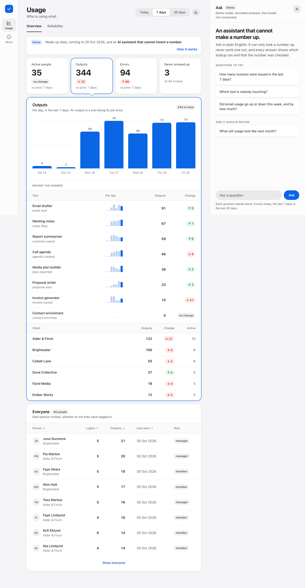
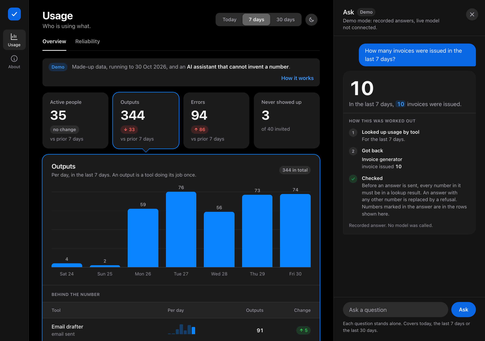
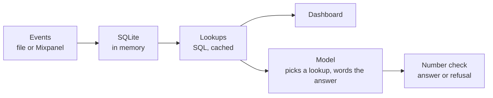

# ask-analytics

A usage dashboard for a company's internal tools, with an assistant that answers questions about it in plain English and can only answer with numbers the dashboard can derive.

**Live demo:** https://ask-analytics-five.vercel.app. A public rebuild of usage reporting I built for a client's internal platform, on a synthetic workspace: eight tools and forty people over sixty days.



## The point

There was no way to answer 'who is actually using what?'. A few earlier attempts had tracked one or two metrics in Mixpanel, but the tracking was unreliable and none of it was ever shown inside the platform itself. Nothing measured who logged in at all, so people who had been invited and never showed up appeared nowhere. The request came from the CEO. The platform's tools touched every part of the business, and he needed real numbers, not anecdotes about what people weren't using, to judge whether the platform was paying for itself.

Every number comes from a lookup: a function that runs one SQL group-by over the events. There are five (usage by tool, activity by person, activity by client, errors seen, and the roster of who was invited), and each takes a window: today, the last 7 days or the last 30 days. The model never does arithmetic and never sees a raw event. It picks a lookup and a window and words the answer. Code then checks that every number in the answer is a number in a lookup result from that same question, and replaces the answer with a refusal if not.



*An answer, with its lookup and the number check.*

## How it works



1. At startup the events and the roster load once into SQLite, from a file or from Mixpanel. The roster is everyone who was invited, so a person with no events still counts. "Today" is the last day of the data, not the wall clock, so answers can be checked exactly.
2. The dashboard reads the lookups. Each tool has one headline event, the single success event that counts as its number, in a typed registry. A tool added without one fails the type check.
3. A question goes to the model with the five lookups as tools. A lookup can return the previous window and the change, so the model has nothing to subtract.
4. Code checks every number in the reply against that question's lookup results. A question no lookup covers, such as a forecast, gets a fixed refusal that names what can be asked.
5. The answer shows its lookup, its window and a request id, so a reader can check it and quote it.

The same five lookups are served over MCP ([mcp.md](docs/mcp.md)). More in [ARCHITECTURE.md](docs/ARCHITECTURE.md).

## Results

Forty questions in four tiers: direct (the wording names the measure and the window), indirect (it names neither), comparisons against the previous window, and ten that must be refused, three of them adversarial. Expected answers are computed from the seed by plain Python that shares no code with the lookups, and scoring is exact match on the number, with no AI judge. A live run asks each question three times; all three must pass.

| Mode | Model | Date | Direct | Indirect | Comparison | Refusal |
|---|---|---|---|---|---|---|
| Fixture | none | 16 Nov 2026 | 12 of 12 | 10 of 10 | 8 of 8 | 10 of 10 |
| Live, first run | `claude-haiku-5-5` | 16 Nov 2026 | 8 of 12 | 9 of 10 | 1 of 8 | 10 of 10 |
| Live, latest run | `claude-haiku-5-5` | 17 Nov 2026 | 12 of 12 | 10 of 10 | 8 of 8 | 10 of 10 |
| Live, held-out | `claude-haiku-5-5` | 25 Nov 2026 | 11 of 12 | 9 of 10 | 7 of 8 | 9 of 10 |

- **Fixture.** The model is played from a script, in `make check`. It cannot show whether a model picks the right lookup.
- **Live, latest run.** The eighth run, after six rounds of fixes. Two reviews of those fixes, after runs 4 and 7, found checks that had been loosened too far, and they were tightened before the next run. The row is partly fitted to these forty questions, since they are what the fixes were tested on.
- **Live, held-out.** Forty more questions, written by a separate agent that saw only the lookup descriptions and the tool and people names. Run once, with nothing tuned on the result: 36 passed. In two failures the number check replaced a correct answer because the model added a count of its own; in one the scorer marked a correct answer wrong; in one a trick question got real figures, not a refusal. In none did a number absent from the lookups reach a reader.

Detail: [docs/EVALS.md](docs/EVALS.md).

## Run it

Needs [uv](https://docs.astral.sh/uv/) and Node 22.

```
cp .env.example .env      # then set ADMIN_TOKEN to any long random string
make setup
make dev                  # backend on :8000, frontend on :3000
make check                # lint, types, tests, fixture evals (40 of 40), build
make browser-test         # a real browser, demo mode
```

Open http://localhost:3000. With no `ANTHROPIC_API_KEY` the Ask box runs in demo mode: it answers the forty eval questions from recorded answers and says the live model is not connected for anything else. Set the key in `.env` for live answers; `make evals` then spends credits. Deployment: [docs/deploy.md](docs/deploy.md).

## Production notes

- **Spend:** the Ask endpoint is limited per visitor (5 a minute by default) and stops for the day at a fixed budget ($2 by default). A question reserves its worst-case cost first, so a burst cannot overshoot.
- **Auth:** the admin token is a secret shared by the frontend's server and the backend, and never reaches a browser. It does not protect spend: the rate limit and the budget do.
- **Failure handling:** model calls have a 30-second timeout and one retry. Lookup results are cached for ten minutes and warmed every five.
- **Tracing:** one JSON log line per question: request id, question, lookups, tokens, cost, latency and outcome.
- **A deployed build cannot pretend:** the Docker image refuses to start in demo mode, without a real admin token, or on any source but the file.
- **Known limit:** rate-limit and budget counters are in memory, which fits one small instance.

## How it was built

Built with AI assistance (Claude Code) under checks I set: a plan reviewed before any code, tests first on the core logic, `make check` and CI with a secret scan on every pull request, and an independent review of each phase's diff. The full build record is kept at the [`build-log` tag](https://github.com/nkanyi-so/ask-analytics/tree/build-log).

## Next

- Stop the number check dropping right answers when the model adds its own count.
- Move the rate limit and budget to Redis.
- Send the Monday summary by email.
